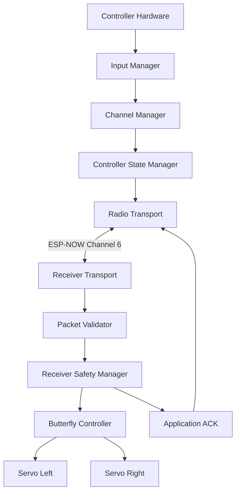

## Transport Headers

- Include `IRadioTransport.h` for the transport contract, configuration, frames, statistics, and constants without ESP32 hardware dependencies.
- Include `EspNowTransport.h` when using the concrete ESP-NOW implementation. It already includes the transport interface.
- Use explicit headers internally. An umbrella header may be introduced in the future if it provides a clear benefit without adding unwanted hardware dependencies.

