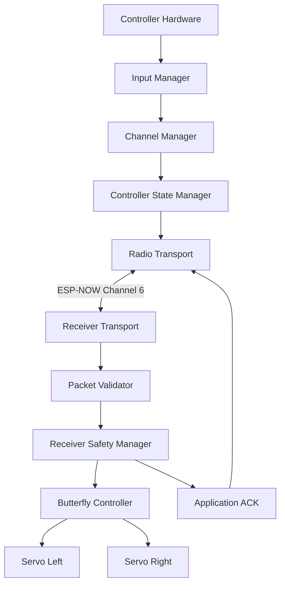

## Transport Headers

- Include `IRadioTransport.h` for the transport contract, configuration, frames, statistics, and constants without ESP32 hardware dependencies.
- Include `EspNowTransport.h` when using the concrete ESP-NOW implementation. It already includes the transport interface.
- Use explicit headers internally. An umbrella header may be introduced in the future if it provides a clear benefit without adding unwanted hardware dependencies.

## Runtime Responsibilities

Controller input sampling/calibration and channel mapping, button debounce/short-press handling, periodic 100 ms control transmission, immediate DISARM transmission, ACK processing, and UI updates are separate non-blocking activities. An unconfirmed application link suppresses ARM requests; a short press while disconnected is ignored rather than queued. Link confirmation is based on a valid application ACK (source, exact size, version, packet type, acknowledged sequence, and defined receiver status), not MAC-layer send success. OLED and buzzer work must not block radio scheduling.

Receiver callbacks only transfer bounded frames to application processing. The main control context validates sender, size, protocol version/type, channel range, sequence freshness, and age before updating state or link health. Safety evaluates timeout before/during/after draining and before output. A validated DISARM anywhere in the bounded drain suppresses ARM across that drain. Servo calculations use receiver-local time in the non-blocking control loop. Invalid, duplicate, stale, or expired frames do not change outputs or refresh link timeout. Servo movement is outside radio callbacks. The output driver is not attached by default: measured compile-time overrides and explicit commissioning are prerequisites. OLED, buzzer, and persistent configuration remain deferred.

## Implemented Composition

- Controller `src/input/`: `InputManager` and `ArmButton`; `src/control/`: universal `ChannelManager` and requested-vs-confirmed `ControllerState`; `src/transport/`: `ControllerLink` and its header.
- Receiver `src/transport/`: validated `ReceiverLink`; `src/safety/`: independent `ReceiverSafety`; `src/control/`: receiver-specific `ButterflyController`; `src/output/`: typed `ServoConfig`, validation, and `ServoOutput`/LEDC driver.
- Each `src/main.cpp` composes its modules and services them without runtime delay. Hardware/timing and optional build-time overrides live under each project's `include/`. Shared RadioProtocol/RadioTransport are reused unchanged.
- Headers live beside their implementation. Both firmware projects build independently with the same pinned Arduino core 3 platform; host tests use fake clocks/transports/drivers, not physical boards.

